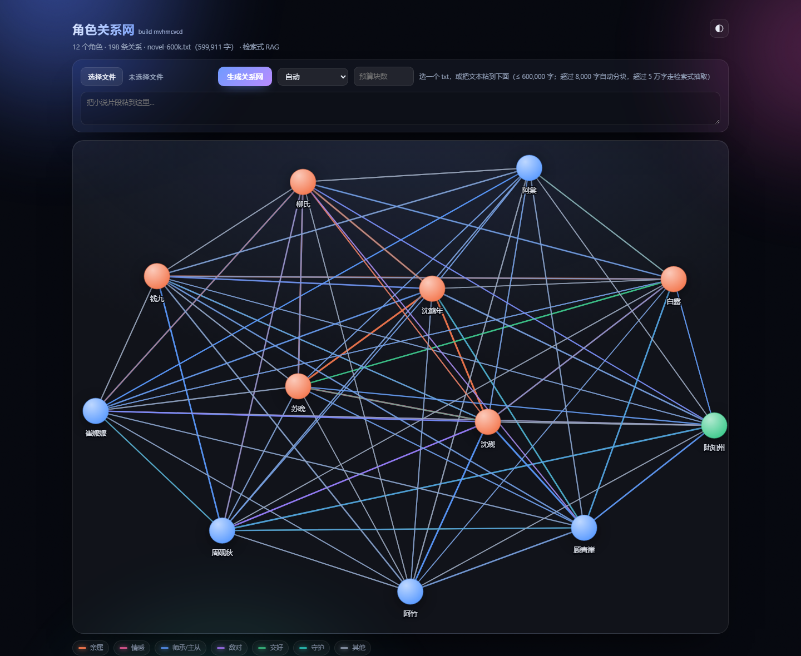
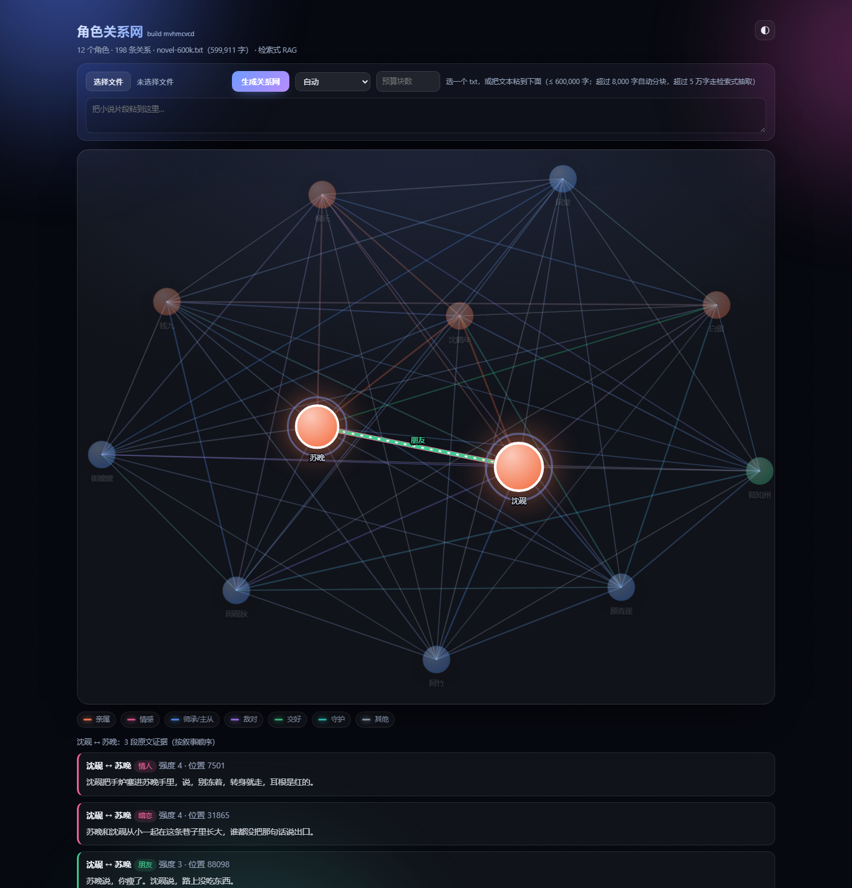

# dsh-character-graph

从一段中文叙事文本里抽出角色和他们的关系，在对话里画成一张可以点、可以拖的力导向关系网。

> A DSH plugin + standalone viewer that extracts characters and relationships from Chinese narrative
> text and draws them as an interactive force-directed graph. Long books are handled by sliding-window
> chunking and BM25 retrieval (no embedding endpoint is assumed), and **every edge must quote the
> source verbatim** — unverifiable edges are dropped and counted, never invented.

**现在能处理 60 万字**：≤8,000 字一次调用；更长的话按 3,500 字滑窗切块、逐块抽取、逐块核对证据、再全局合并；超过 5 万字还会先扫角色表、用检索挑出值得精读的块（RAG）。60 万字全量实测：**195 块 / 207 次调用 / 664k 输入 tokens / $0.42 / 118s（并发 6）**，证据逐字核对 100% 通过。

**当前版本 0.3.0**（2026-10-21）· [更新日志](#更新日志) · [CHANGELOG.md](CHANGELOG.md) · [GitHub Releases](https://github.com/cong7781/novel/releases)



## 安装（装进别人的 DSH）

插件本体是**零 npm 依赖 + 预构建客户端**：`lib/client.js` 已经把 d3-force 打进去了，安装时不需要构建、不需要装任何第三方包。

三种来源都行（DSH 的插件页侧边栏，或对话里的 `plugin_manager` 工具）：

```text
# 1) 从 GitHub 安装（推荐，先发仓库再发 npm）
github:cong7781/novel

# 2) 从 npm 安装（如果你 npm publish 了）
dsh-character-graph

# 3) 本地目录（开发时用，绝对路径）
D:\code\dsh-character-graph
```

- 装完会作为新组合包**默认启用**，并写进 profile 的 `package.json` / `cordis.patch.yml`；HMR 开着时立即生效，宿主要重启才读到新 `lib/index.js` 的情况见下面「限制」。
- 安装/启停属于 profile 操作，**需要 `danger-full-access` 或逐次批准**；pnpm 若拦下依赖构建脚本，还要单独批准（本插件没有构建脚本，正常不会遇到）。
- 用 GitHub 地址时，DSH 会先 `git ls-remote` 探一次仓库连通性；GitHub 不可达会直接报错，不会把 profile 改坏。
- **仓库名是 `novel`，包名是 `dsh-character-graph`**：DSH 按 `package.json` 的 `name` 注册插件与工具，两者不必一致，但填安装 spec 时要用 `github:cong7781/novel`。
- 如果安装报 `Permission denied (publickey)`：`github:` 简写会被展开成 SSH 地址，改成 `https://github.com/cong7781/novel`，或先配 SSH key。

**装上就能用**，因为抽取走的是**对方 DSH 自己的模型**（`ctx.llm` + `ctx.agentDefaultModel`）：不需要任何 API key，也不需要本地服务，费用记在他们自己的账号上。前提只有一个：对方的 DSH 里配置了默认模型。

插件的 `files` 只发布 `lib/`、`locale/`、`fixtures/`、`icon.svg`、`cordis.patch.yml`。**命令行与独立查看器不在安装包里**（它们需要额外的 `esbuild` 和一枚 DeepSeek key），想用就 clone 仓库看下一节。

## 三档能力（都已落地并实测）

| 文本规模 | 路径 | 关键机制 | 实测 |
|---|---|---|---|
| ≤ 8,000 字 | 单次调用 | 一次 `ctx.llm`，全文进提示词 | 8,817 字 → 1 次调用、3.8s、$0.0012 |
| 8,000 – 50,000 字 | 滑窗分块 | 3,500 字/块、12% 重叠、逐块闸门、按人物 id/名字全局合并 | 8,817 字 → 3 块、3 次调用、$0.0030 |
| 50,000 – 600,000 字 | 检索式（RAG） | 角色扫描 → BM25 检索候选块 → 只精读选中的块 → 合并 | 101k 字 → 33 块、45 次调用、$0.0725；600k 字 → 195 块、$0.42 |

上限是硬边界：`MAX_CHARS = 600000`，超了报错并说清楚下一步，不静默截断。

## 用起来是什么样

装进 DSH 之后**立刻就有**的是对话里的关系图卡片；网页端和命令行属于**仓库里的开发/长文本工具**，不在安装包里（原因见上面的「安装」一节）。

**1）对话里（装完就有）** —— 调 `extract_characters({ path })` 或粘贴文本，那一刻的工具卡片里就是图：点一次看某人的关系，再点一次看两人之间的原文证据，`?pair=` 深链、丢弃计数都在卡片上。≤600k 字都能跑，但一本 60 万字的书在工具调用里跑 2 分钟并不合适，长书建议走命令行。

**2）网页端（需要 clone 仓库，功能最全）** —— 在仓库目录跑 `node scripts/serve.mjs`（Windows 上也可以双击 `启动关系网.cmd`，macOS/Linux 用 node 命令），它起一个只监听 `127.0.0.1:19401` 的本地服务并打开页面。前置条件只有两样：`npm install`（为了 esbuild 构建页面）和一枚 DeepSeek key（或本机 `~/.dsh/.credentials.yaml`）。页面顺序是「抬头 → 选文件/粘贴框 → **关系图** → 图例 → 两人证据 → 运行与技术信息」：图占满首屏（最宽 1180px、最高约 920px 且不超过视口高度的 80%，节点半径随画布放大到 23px），成本、tokens、丢弃原因、别名合并、历史产物这些技术信息全部放在图**下面**。

- 选文件或粘贴文本 → 提交后是**任务**而不是一个卡住的请求：粘贴框下面出现进度条（块 12/33、已用 40s、输入 34k tokens），完成一块计数就动一块；
- 图**下面**是**统计面板**：字数、分块/抽取、调用次数、输入/输出 tokens、成本、模型耗时、每万字成本与耗时、逐字证据通过率、丢弃条数与原因、别名合并次数；
- **历史产物**下拉里是 `out/runs/` 的每次运行（含命令行跑的），点一下就载入，不用重跑；
- 图上两次点击：先点一个人看他的关系，再点第二个人看**这两人之间**的原文证据；服务在跑时还会额外给出「原文检索：8 段共现片段」，明确标注是检索结果、未经关系判定。

**3）命令行（需要 clone 仓库，可重放、可续跑）** —— 每次运行都会把中间产物写进 `out/runs/<名字>/`：

```bash
# 8.8k 自带测试文本，三种模式各跑一遍
node scripts/extract-cli.mjs --path fixtures/sample.txt --out out/runs/m1-single-final --mode single
node scripts/extract-cli.mjs --path fixtures/sample.txt --out out/runs/m1-chunk-final  --mode chunk
node scripts/extract-cli.mjs --path fixtures/sample.txt --out out/runs/m1-rag-final    --mode rag

# 10 万字：造文本 → 全量抽取（33 块）
node scripts/make-longtext.mjs --target 100000 --out out/texts/novel-100k.txt --seed 7
node scripts/extract-cli.mjs --path out/texts/novel-100k.txt --out out/runs/m2-100k --mode rag --concurrency 5

# 60 万字：先只出检索计划（0 次模型调用），再按预算精读
node scripts/extract-cli.mjs --path out/texts/novel-600k.txt --out out/runs/m3-600k-plan --mode rag --plan-only --cast-from out/runs/m2-100k
node scripts/extract-cli.mjs --path out/texts/novel-600k.txt --out out/runs/m3-600k-budget --mode rag --max-blocks 40 --cast-from out/runs/m2-100k

# 失败/中断后：只补没做完的块，已完成的不再调用模型
node scripts/extract-cli.mjs --path out/texts/novel-100k.txt --out out/runs/m2-100k --mode rag --resume

# 打分与对比
node scripts/eval-graph.mjs out/runs/m3-600k-full/result.json out/texts/novel-600k.manifest.json
node scripts/compare-graphs.mjs out/runs/m1-single-final/result.json out/runs/m1-chunk-final/result.json
```

## 管线：分块 → 检索 → 精细抽取 → 合并

```
文本
 └─ 归一化（CRLF→LF、去 BOM）→ 硬上限 600k
     └─ 滑窗切块  3,500 字/块，下限 2,600、上限 5,000，~12% 重叠
         ├─【RAG】阶段1 角色扫描：等距抽 12 块，只问「谁出现了、还有什么别名」
         ├─【RAG】阶段2 检索：字 bigram BM25 + 精确名字匹配 →
         │        候选块 = 出现 ≥2 个角色的块；候选对 = 同现 ≥2 块的两人；按共现次数排序
         ├─ 精细抽取：只对选中的块调用模型，提示词带上全文角色表和本块的重点人物对
         ├─ 逐块闸门：evidence 必须在本块原文里逐字存在（否则最长公共片段 ≥12 字重锚，再不行丢弃）
         └─ 全局合并：别名消解 → 边重映射到全文坐标 → 跨块证据去重 → 每对人物最多 3 条
```

**为什么是 3,500 字 / 12%**：8,817 字的自带文本在 4,000 字/块时会切成 2 块，人物对覆盖比单次调用少 1 对；改成 3,500 字后切成 3 块，人物对 17 ≥ 单次的 16，且证据条数从 16 涨到 35。切块太小会让系统提示与重叠的固定开销占比上升（每万字输入 tokens 从 7,670 涨到 9,558 就是这笔账）。

**为什么用 BM25 而不是 embedding**：这个 provider 没有 embedding 接口，硬造一个向量索引只会多一层不可解释的失败点。角色图检索的查询永远是「一个名字/一对名字」，而中文人名就是 2–4 个字，字 bigram 的精确匹配比稠密向量更合适，且零依赖、可复现、可在断点续跑时几毫秒重建（60 万字建索引 ~0.2s）。

**RAG 到底省了什么**（可以核对，不是口号）：

- 一道**结构性过滤**：一个块里只出现 1 个角色时不可能存在「两人关系」，直接不调用模型；
- 一道**预算**：`--max-blocks` 按「这个块能服务多少组候选人物对」排序花预算，跳过的块计入 `plan.json` 的 `skippedByReason`（`too-few-characters` / `no-selected-pair` / `over-budget`）；
- 一次**角色表注入**：把全文角色名（含别名）给到每个块，模型不用在各块里给同一个人起不同名字，合并阶段的别名合并次数因此可查（600k 全量 2,295 次）。

## 中间产物与断点续跑（失败能续）

一次运行 = 一个目录，全部是 JSON：

```
out/runs/<名字>/
  text.txt         归一化后的原文（所有 charStart 都指向这份文本）
  manifest.json    文本 hash、模式、模型、分块参数
  chunks.json      每块的 [start, end)
  cast.json        RAG 阶段1 的角色表 + 别名（含 textHash，续跑直接复用，不重扫）
  plan.json        候选人物对、选中的块、被跳过的块与原因
  blocks/0000.json 单块的抽取结果 + 逐字校验后的边（可续跑的最小单位）
  failures.json    重试后仍失败的块（续跑会重试）
  result.json      合并后的图（前端吃的就是它）
```

续跑的判定很严格：`manifest.json` 里的文本 hash、模式、模型三者都对得上才复用块；对不上就忽略旧产物重新跑，不会把两本书的中间结果拼在一起。实测：100k 那次有 1 块 JSON 解析失败，`--resume` 只补了这一块（12 次扫描 + 1 次抽取 → 实际只用了 1 次抽取调用，因为 cast.json 也复用了）。之后又把「JSON 解析失败」改成**自动重试一次**（第二次提示词加一句「上次不是合法 JSON」），这类失败不必再靠人工续跑。

## 证据闸门：没有为省成本退让一步

每条边都必须带 `evidence`，而且这段文字必须在**模型当时看到的那一块**里逐字存在：

1. 去空白后 `indexOf` 命中 → 记下块内偏移，合并时换算成全文 `charStart`；
2. 没命中 → 最长公共片段 ≥12 字就重锚到真实区间，标 `repaired: true`；
3. 还是找不到 → **丢弃**，计入 `stats.dropped`，并按原因分类。

分块并没有放松这条，反而多出三类「策略性丢弃」，页面和 CLI 都逐项写清楚：

| 原因 | 含义 | 是否核对失败 |
|---|---|---|
| `evidence-not-in-source` | 原文里找不到这段引文 | **是** |
| `evidence-too-short` | 证据短于 6 字 | **是** |
| `duplicate-evidence` | 重叠窗口里的同一句被引用了两次 | 否，引文是对的 |
| `pair-cap` | 同一对人物已有 3 条证据（上限） | 否 |
| `too-many-edges-for-pair` | 单块内同一对超过 3 条 | 否 |
| `self-after-merge` | 别名合并后这条边指向自己 | 否 |

所以 `evidencePassRate` 的分母只算**核对失败**，不是「丢弃总数」：600k 全量跑丢弃 3,206 条，其中核对失败 0 条，通过率 100%，页面同时写着「丢弃 3,206（重复 1,229 / 上限 1,971 / 单块上限 6）」。这两种数字要分开，否则重叠越多、通过率看着越差，会掩盖真相。

## 测量（先测量再优化）

成本按 DeepSeek 官方定价页上 `deepseek-flash`/`deepseek-chat` 的**峰值**单价折算（输入 $0.30 / 输出 $1.20 每 1M tokens；低谷是半价，缓存命中另算），可用 `CHARACTER_GRAPH_PRICE_INPUT` / `_OUTPUT` / `_PRICE_CACHE_HIT` 覆盖。tokens 全部来自接口返回的 `usage`（宿主半没有 usage 回传时会标 `tokens.estimated`）。

| # | 文本 | 模式 | 字数 | 块 | 调用 | 输入 tok | 输出 tok | 模型耗时 | 墙钟 | 成本 | 每万字成本 | 每万字模型耗时 | 证据通过率 | 角色/边/人物对 |
|---|---|---|---|---|---|---|---|---|---|---|---|---|---|---|
| 1 | fixtures/sample.txt | 单次 | 8,817 | 1 | 1 | 6,763 | 905 | 3.7s | 3.8s | $0.0012 | $0.0014 | 4.2s | 100% | 9 / 16 / 16 |
| 2 | 同上 | 分块 | 8,817 | 3 | 3 | 8,427 | 2,307 | 9.2s | 3.1s | $0.0030 | $0.0034 | 10.4s | 100% | 9 / 35 / **17** |
| 3 | 同上 | RAG | 8,817 | 3 | 6 | 16,263 | 2,622 | 12.0s | 4.8s | $0.0078 | $0.0088 | 13.6s | 100% | 9 / 34 / **18** |
| 4 | novel-100k | RAG 全量 | 101,003 | 33 | 45 | 139,536 | 35,201 | 119.1s | 31.2s | $0.0725 | $0.0072 | 11.8s | 100% | 12 / 159 / 64 |
| 5 | novel-600k | RAG 预算 40/195 | 599,911 | 40 | 40 | 128,987 | 38,225 | 136.0s | 24.3s | $0.0816 | $0.0014¹ | 2.3s¹ | 100% | 12 / 160 / 64 |
| 6 | novel-600k | RAG 全量 | 599,911 | 195 | 208² | 664,277 | 197,070 | 677.1s | 118.1s | $0.4203 | $0.0070 | 11.3s | 100% | 12 / 198 / **66** |

> 模型耗时 = 所有单次调用延迟之和；墙钟 = 并发 5–6 下的实际耗时。两者都要看：成本跟 tokens 走，等待跟墙钟走。
> ¹ 第 5 行只读了 195 块里的 40 块（20.5%），每万字成本是按**全文 60 万字**摊的，所以看着便宜；按实际读的 13.5 万字算是 $0.0070/万字，和第 6 行一致。RAG 的节省体现在「用 20% 的调用拿到 15/15 明写关系、64/66 同现人物对」，见下。
> ² 第 6 行是 12 次角色扫描 + 195 次抽取 = 207 次调用，其中 1 块（#48）回复不是合法 JSON，`--resume` 补跑 1 次（那次之后这个失败会自动重试一次，不必等人工续跑）。表里的 tokens / 成本 / 模型耗时取自补跑合并后的 `result.json`，墙钟取自首次那次（118.1s）。

截图（`?still=1` 冻结动画，都在 `docs/screenshots/`）：60 万字全量结果、沈砚↔苏晚的两人视图（含 8 段原文检索）、以及直接双击打开的 file:// 静态页（10 万字结果）。



**合成长文本上的召回**（`scripts/eval-graph.mjs`，manifest 里有 12 个角色、15 组明写关系、66 组同现人物对）：

| 运行 | 角色召回 | 明写关系召回 | 同现人物对 | 错误合并 | 平均证据/对 |
|---|---|---|---|---|---|
| 100k 全量 | 12/12 | 15/15 | 64/66 | 无 | 2.48 |
| 600k 预算 20.5% | 12/12 | 15/15 | 64/66 | 无 | 2.50 |
| 600k 全量 | 12/12 | 15/15 | 66/66 | 无 | 3.00 |

**这两组数字要一起读**：这份合成文本里每个角色在几乎每个块都会出现，所以抽 20% 的块也能覆盖全部人物对——这**不代表**真实长篇也能这样。真实小说里稀有关系集中在少数块，预算一旦小于覆盖这些块的量就会掉召回；检索排序（同现次数 + 覆盖度）就是为这种情况准备的。默认**不设预算上限**（`maxBlocks = ∞`），预算只是给你一个「先花 5 分钟看看」的旋钮。

**8,817 字自带文本的等价性检查**（第 1–3 行）：人物 9/9 相同；人物对 16 → 17（分块）→ 18（RAG），没有丢人物；可读的叙事证据从 16 条涨到 34–35 条；通过率保持 100%。这就是「等价或更好」的判定标准——不是边数越多越好，而是**人物对不减少、证据不掺假**。

## 关系类型（线上那两个字）

每条边除了证据和强度，还有一个**关系类型**：亲子、兄弟姐妹、夫妻、情人、师徒、主仆、朋友、盟友、敌对、宿敌、同僚、上下级、亲戚、暗恋、暗中保护、理念冲突、其他。

- 这是**封闭词表**：提示词只允许从这 17 个词里选，服务端 `normalizeRelation()` 再把「父子/老师/仇人/恋人」这类说法收敛到同一个词（未知一律落 `其他`）。
- 只有被高亮的边才画线上标签（十二个人物全标就成一团），两人模式下标签落在连接他们那条线的中间。

## 视觉与动效

**外壳**：深色极光背景（三团缓慢漂移的高斯光斑 + 颗粒噪声），面板是玻璃拟态（`backdrop-filter` + 1px 描边 + 大投影），标题走渐变文字，右上角 `◐` 一键切深浅色（记在 localStorage）。`?still=1` 停下所有动画（截图/录屏用）。

颜色是**语义**的，不是装饰：

| 类别 | 关系类型 | 颜色 |
|---|---|---|
| 亲属 | 亲子 / 兄弟姐妹 / 夫妻 / 亲戚 | 珊瑚红 |
| 情感 | 情人 / 暗恋 | 洋红 |
| 师承·主从 | 师徒 / 主仆 / 同僚 / 上下级 | 蓝 |
| 敌对 | 敌对 / 宿敌 / 理念冲突 | 紫 |
| 交好 | 朋友 / 盟友 | 绿 |
| 守护 | 暗中保护 | 青 |

- 人物按自己最强的那条关系取色，圆是径向渐变（上高光、下本色）；
- **布局拉满画布**：每对人物只有一根布局弹簧（同一对的三条证据不会叠成三倍拉力，否则整张图会缩成一小团），
  收敛后把布局**双向拉伸**到画布内框（纵横比最多 1.6:1，节点和文字本身不变形）——所以关系网占的是整块画布，
  不是中间一块圆斑；
- 入场错峰缩放淡入、连线一笔画出来；收敛后保留极低 alpha 让整张网呼吸；
- 选中的人物有呼吸光环 + 同色外发光；两人模式下连接他们的边加粗、上面有流动光点；
- 证据行逐条淡入上移，左侧竖线用该关系的类别色；检索片段用灰蓝竖线，和「已校验证据」区分开；
- `?still=1` 关闭全部动效；系统开了「减少动态效果」时自动同样处理。

### 人多了怎么画（一次 457k 字真实运行后加的）

一本 45 万字的小说抽出 **98 个角色 / 539 条关系**，按老办法画就是一团毛线。现在的规则是：

| 招 | 做法 |
|---|---|
| 只画主要人物 | 默认上场次最多的 **40 位**，「运行与技术信息」里的「显示」下拉可切 20 / 40 / 80 / 全部；布局按当前可见的人重新填充画布 |
| 同一对只画一条线 | 三条证据不再叠三条线，画一条（按最强的那条上色，额外节拍加粗一点）；证据仍在两人面板里逐条列出 |
| 节点随人数缩小 | 半径 `23 × √(20/人数)`，98 人时约 10px；名字字号同步降到 8–12px |
| 标签避让 | 按出场次数贪心摆放，会和已放标签重叠的就先不显示（选中的一定显示） |
| 边降噪 | 超过 80 / 160 条时整层透明度降到 0.55 / 0.42，选中两人时其余自动退到背景 |
| 卡片上限 | 对话里的卡片固定画出场最多的 40 位，并写明「共 98 位，N 位未画」 |

`?run=<目录名>` 可以直接打开某次历史运行，不再受「页面构建时的数据」限制。

## 数据契约

`output.schema`（也是前端消费的全部数据，v2）。下面是**真实产物**的字段示例（数值取自 60 万字与 45 万字两次运行，省略部分字段）：

```jsonc
{
  "nodes": [{ "id": "n1", "name": "沈砚", "aliases": ["少爷"], "mentions": 2573, "independent": 2511 }],
  "edges": [{
    "source": "n1", "target": "n2",
    "relation": "情人",
    "evidence": "沈砚把手炉塞进苏晚手里，说，别冻着，转身就走，耳根是红的。", // 原文逐字片段
    "strength": 4,          // 1..5，模型判断，不是原文事实
    "charStart": 7501,      // 证据在全文中的起始位置（叙事顺序）
    "repaired": false,      // 是否经过重锚
    "chunk": 2              // 来自哪一块（可追溯到 blocks/0002.json）
  }],
  "stats": {
    "chars": 599911, "chunks": 195, "chunksExtracted": 40, "chunksFailed": 0, "chunksReused": 0,
    "modelNodes": 477, "modelEdges": 666, "nodes": 12, "edges": 160,
    "verified": 154, "repaired": 6, "dropped": 506,
    "droppedReasons": [
      { "reason": "pair-cap", "count": 277 },
      { "reason": "duplicate-evidence", "count": 225 },
      { "reason": "self-after-merge", "count": 3 },
      { "reason": "too-many-edges-for-pair", "count": 1 }
    ],
    "evidenceFailed": 0, "evidencePassRate": 1,
    "calls": 40, "callsRetried": 0,
    "tokens": { "prompt": 128987, "completion": 38225, "cacheHit": 10240, "estimated": false },
    "costUsd": 0.0816, "cost": { "input": 0.0357, "output": 0.0459 },
    "elapsedMs": 24266, "modelMs": 135991,
    "per10k": { "promptTokens": 2150, "completionTokens": 637, "seconds": 2.3, "costUsd": 0.0014 },
    "aliasMerges": 454, "aliasDeclarations": 1, "duplicateEvidence": 225, "suspects": 0,
    "genericDropped": 44, "genericExamples": ["小姐", "护士", "服务生", "老人", "医生"],
    "aliasRefusals": [{ "alias": "奥丁", "claimedBy": "神", "reason": "independent-character", "occurrences": 240 }],
    "pairCapTop": [{ "a": "路明非", "b": "诺诺", "count": 12 }],
    "mergeReport": "merge-report.json",
    "rag": {
      "enabled": true, "castSize": 9, "pairs": 36, "candidateBlocks": 195,
      "selectedBlocks": 40, "skippedBlocks": 155,
      "skippedByReason": [{ "reason": "over-budget", "count": 155 }],
      "savedBlocks": 155, "savedRatio": 0.795, "estimatedSavedUsd": 0.316
    },
    "mode": "rag"
  },
  "source": { "name": "novel-600k.txt", "chars": 599911 },
  "chunks": [{ "index": 0, "start": 0, "end": 3503, "chars": 3503, "overlapPrev": 0 }],
  "cast": [{ "name": "沈砚", "keys": ["沈砚", "少爷", "小先生"] }],
  "plan": { "pairs": [{ "a": "沈砚", "b": "苏晚", "cooccurrence": 33 }], "selectedBlocks": [0, 1, 2], "skippedByReason": [] }
}
```

`?pair=n1,n2` 深链打开就选中这两个人；服务端另有三个只读接口：`GET /api/runs`（历史产物）、`GET /api/runs/:id`（整份结果）、`GET /api/pair?run=…&a=名字&b=名字`（已校验的边 + 原文共现片段）。

## 三个实现上的决定

**卡片走 `tool.call.toolview` 座位，不是静态 HTML。**
客户端插件注册 `{ name: 'tool.call.toolview', key: 'extract_characters' }`，在对话流里就地渲染 React 组件，跟随会话生命周期，随日志回放重建。

**结构化数据走 `presentationMeta` → `block.meta`。**
工具的 `value` 明确不回放给前端，而 `presentationMeta` 随 `tool/result` 持久化、刷新后还在，又不进模型上下文。代价：Code Mode 的嵌套分派不计算 meta，所以卡片对 `meta == null` 有明确的降级文案。

**`d3-force` 只做布局，DOM 归 React。**
`d3-force` 在 rAF 里算坐标写进 ref，React 负责画 `<circle>/<line>`；拖拽直接用 pointer 事件设 `fx/fy`。把 SVG 交给 d3-selection 会和 React 抢同一批节点。

## 局限与下一档风险

1. **别名消解仍是软肋。** 现在靠三条证据：模型在块内声称的别名、原文里的「A，人称 B」句式、以及**同块共现冲突**（两个名字在同一块里作为不同人物出现过 → 永不合并）。100k/600k 两次都没有错误合并，但这是合成文本；真实小说里「老爷/太太/少爷」这类称谓被两个人共用、且两人从未同块出现时，仍可能被误并。策略是**保守**：拿不准就不合并，`stats.suspects` 报出疑似同一人的组，页面写明。300 块规模的那次早期版本确实把沈砚和沈鹤年合并了（父子变一人），正是同块共现规则修掉的——这类回归必须靠 `eval-graph.mjs` 的错误合并一栏守住。
2. **检索是词法的。** 「那个卖药的姑娘」这种改写查不到；跨章指代（「她」）也进不了检索。没有 embedding 接口，这是有意的取舍；真要做语义召回，得先有向量服务。
3. **合成文本偏乐观。** 每个块都含大量角色，所以预算实验的召回不掉。真实长篇要先用 `--plan-only` 看 `plan.json` 的候选块分布，再决定预算。
4. **成本与时延。** 60 万字全量 $0.42 / 118s（并发 6，峰值价）。再往上（100 万字）就是线性放大：$0.7 / 3–4 分钟。真正的瓶颈是**并发下的限流**与**单块失败重试**，不是钱。
5. **每对人物最多 3 条证据**是给「两人情节」读的，不是越多越好；要更丰富可以 `--max-evidence-per-pair 6`，代价是图变密。
6. **600k 是硬上限。** 更大的书需要分卷跑再合并 `result.json`，合并脚本还没写（当前 `mergeChunkGraphs` 只吃单次运行的块，跨 run 合并要重新分配 id）。
7. **宿主半的 tokens**：早先是按字符数估算的；现在读 `ctx.llm` 流里的 `usage` 块（`tokens.estimated: false`），只有 provider 不回 usage 时才退回估算。
8. **对话流里的卡片没有进度**：工具调用是一个同步返回，进度条只在网页端（任务式接口）。
9. **别名吸收的规则是保守的**：拼写变体、双向声称（两个名字互相把对方列为别名）、或该名字本身几乎不单独出现（< 20 次）才允许合并，其余一律拒绝并写进 `aliasRefusals`。45 万字的真实书里，这条规则把 `夏弥`/`圣女`/`老大` 从「别人的别名」里救了回来；代价是少数真别名会被拆成两个节点（`陈墨瞳`↔`诺诺`、`夏弥`↔`耶梦加得`），需要人工白名单或后续用「本名/真名」式声明补上。
10. **P2/P3 里还没做的**：角色名清单按块裁剪（会牺牲前缀缓存）、`minCooccurrence` 的自适应、把宿主工具的中间产物从 `%TEMP%` 挪到 `out/runs`、把 cast 失败/泛称/可疑合并做成工具结果里的 `warnings[]`。

## 更新日志

最新版本 **0.3.0**（2026-10-21）。完整记录见 [CHANGELOG.md](CHANGELOG.md)，每个版本都有 [GitHub Release](https://github.com/cong7781/novel/releases)。

### 0.3.0 — 合并与命名、大图显示、宿主适配器

这一轮全部来自一次 **457,215 字**的真实运行（江南《龙王：世界的重启》，抽出 135 个角色 / 625 条关系后暴露的问题）。
所有数字都是 `--resume` 重算同一批 blocks（**0 次模型调用**）。

**合并与命名（可信度）**

- **规范名不再被最短标签抢走**：旧实现用纯子串计数投票，`楚` 把 762 次 `楚子航` 都算成自己，于是节点叫「楚」、带 20 个别名。
  改成独立出现计数（被更长名字覆盖的不计）后，这本书的节点名是 **`楚子航`**（独立 759 次）。
- **别名吸收要证据**：拼写变体（`楚` ⊂ `楚子航`）、双向声称（`诺诺` ↔ `陈墨瞳`）、或该名字本身几乎不单独出现（`晚娘` 全书 2 次）；
  否则拒绝合并、保留两个节点，并写进 `merge-report.json`。**`夏弥`（87 次独立出现）不再被并进 `诺诺`。**
- **泛称不再当人物**：~140 个身份/集体名词 + 「们」「…的人」规则，这本书剔掉 **49 个**（护士、老板、中年人、船员们…），
  牵连的边计入 `dropped: generic-name`，页面上写清计数和例子。
- 每个合并决定落盘到 `out/runs/<run>/merge-report.json`（独立出现次数、200 条拒绝合并、泛称、存疑组）。

**大图显示（人一多就成毛线）**

- 每对人物只画一条线（最强证据着色，额外节拍加粗），证据仍在两人面板里逐条列出；
- 默认只画出场最多的 **40 人**，「运行与技术信息 → 显示」可切 20 / 40 / 80 / 全部，布局按可见节点重新填满画布；
- 节点半径 `23 × √(20 / 人数)`（98 人时约 10px）、字号 8–12px、标签贪心避让、密集时边透明降噪；
- 对话卡片固定画出场最多的 40 人并写明未画数量；`?run=<目录名>` 直接打开某次历史运行。

**宿主适配器**

- 从 `ctx.llm` 流里读**真实 usage**（`tokens.estimated: false`），不再按字符数估算；
- 模型只回空正文（思考过程吃掉输出额度）时按 2× 预算重试，最终报错里写明「其中 N tokens 是思考过程」；
- 角色扫描预算 900 → 2048；RAG 计划为空时按原因分别报错，而不是「所有 0 个分块失败」；
- `esbuild` 在受限沙箱里无法启动时，`build-viewer.mjs` 回退到内联打包。

**实测（同一份文本）**

| | 0.2.0 | 0.3.0 |
|---|---|---|
| 角色 / 关系 | 135 / 625 | **98 / 539** |
| 泛称作节点 | 17+ | **0**（49 个被剔除） |
| 逐字证据通过率 | 100% | 100%（核对失败 0 条） |

100k 字合成文本回归：12 角色 / 159 边 / 100% 通过，与 0.2.0 一致。

**这一版的代价（已记录，不藏）**

- 保守合并会拆开「正式名和常用名都高频出现」的同一个人：本书里 `陈墨瞳`（45 次）与 `诺诺` 分成两个节点，
  `夏弥`（87 次）与 `耶梦加得` 也分成两个节点——原文没有「本名/真名」式句子（全文 0 命中），无法自动证伪，
  两者都写成 `aliasRefusals` / `suspects`。要更激进的合并，配 `aliases.json` 人工白名单即可（尚未实现）。
- 未做：`其他` 关系占比偏高（26%）、前缀缓存未优化、宿主产物仍在 `%TEMP%`、工具结果还没有 `warnings[]`。

### 0.2.0 — 首个公开版本

- 滑动窗口分块（3,500 字/块、12% 重叠）+ 逐块抽取 + 逐字证据闸门 + 全局合并；
- 5 万字以上先扫角色表，再用 BM25 字 bigram 检索挑候选块做精细抽取（不依赖 embedding 接口）；
- 中间产物落盘（`blocks/*.json`、`cast.json`、`plan.json`、`result.json`）与断点续跑；
- 60 万字全量实测：195 块 / 207 次调用 / 664k 输入 tokens / **$0.42** / 118s（并发 6），证据通过率 100%；
- 独立查看器：任务式进度、成本与丢弃原因面板、两人情节原文检索、历史产物切换。

## 开发

```bash
node scripts/build-client.mjs        # src/client.jsx + d3-force → lib/client.js
node scripts/build-viewer.mjs [data.json] [out.html]   # 静态页（数据 + d3 全内联）

node scripts/test-highlight.mjs      # 选中态 → 高亮集合的纯函数断言
node scripts/test-host.mjs           # 解析 / 证据核对 / 重锚 / 丢弃 的断言
node scripts/test-pipeline.mjs       # 分块 / BM25 / 合并别名 / 检索计划 / 续跑 / 证据闸门（离线）
node scripts/test-client.mjs         # 客户端 bundle 契约 + 降级分支冒烟
node scripts/test-serve.mjs          # 真跑一次本地服务（会调用模型）
node scripts/probe-model.mjs         # 接口连通性与单次调用 token/延迟

node scripts/extract-cli.mjs --help  # 所有开关
node scripts/make-longtext.mjs --target 100000 --seed 7
node scripts/eval-graph.mjs <result.json> <manifest.json>
node scripts/compare-graphs.mjs <base.json> <candidate.json>
node scripts/inspect-session.mjs <session.v4.jsonl.zstd>   # 从会话日志里读回 tool/result 的 meta
```

`src/highlight.js` 是选中行为的唯一实现，组件和测试都从这里取；`lib/extract.js` 是提示词、JSON 修复与证据闸门的唯一实现，宿主、服务、CLI、断言都从这里取——所以「点谁、亮什么、哪条边能留下」都是可断言的。

## 环境与安装注意

- 本地服务用 `~/.dsh/.credentials.yaml` 里的 `DEEPSEEK_API_KEY`（可被环境变量覆盖），key 只在该进程内读，**不进日志、不进产物、不回给浏览器**；服务只监听 `127.0.0.1`，自身没有鉴权，别把端口暴露出去。
- 宿主代码改动要重启 DSH（Cordis 用 ESM 缓存）；前端 `lib/client.js` 每次从磁盘读。
- 安装到 profile 是**拷贝**不是软链：改了 `lib/` 要重装（或把 `lib/`、`fixtures/` 同步到 profile 的 `node_modules/dsh-character-graph/`）。
- 开发与发布流程见 [docs/RELEASING.md](docs/RELEASING.md)；CI 只跑离线断言（`test-serve` / `probe-model` 需要真实模型）。
- 截图：`msedge --headless=new --disable-gpu --screenshot=... --virtual-time-budget=12000 "http://127.0.0.1:19401/?still=1"`（`?still=1` 冻结动画，`&pair=n1,n2` 直接拍两人视图，`&run=<目录名>` 指定读哪个 run 的原文做检索）。
